# ADR 0002: Challenge Detection

- Status: Accepted
- Date: 2026-10-21
- Decision owners: AgentTab maintainers
- Applies to: extension detector, Core RPC v1 result and parameter schemas, host audit, OMP, MCP, and SDK adapters
- Builds on: ADR 0001 § Attention notices, which already requires CAPTCHA to reach the human through an attention notice

## Decision

AgentTab detects bot challenges on task-owned tabs and reports each one as a typed `challenge` result member carrying a detector-derived next step. Agents learn about a challenge from the result of the operation that hit it, instead of from failed clicks, empty snapshots, or timed-out waits.

| Area | Decision |
| --- | --- |
| Surface | No new Standard tool. Detection runs inside `browser_open`, `browser_snapshot`, `browser_act`, and `browser_wait`. |
| Event | `challenge` conforms to [`schemas/rpc/v1/challenge.schema.json`](../../schemas/rpc/v1/challenge.schema.json). |
| Detection | Extension-side, read-only, driven by a bundled signature catalog. Only challenges that gate the page are reported; passive vendor presence never emits. |
| Clearing | One new `browser_wait` condition and one new `browser_handoff` completion kind, both `challenge_cleared` and both verified by the detector. |
| Enforcement | Standard mode refuses element input inside an active challenge surface with `outcome: "needs_user"`. |
| Solving | Excluded from Standard mode. Solvers need the arbitrary JavaScript, token writes, or coordinate input that ADR 0001 keeps out of Standard mode. |
| Records | Local audit gains an enum-only `challenge` summary. No product telemetry and no remote catalog. |

## Context

ADR 0001 routes CAPTCHA to an attention notice, but the runtime recognizes none. The agent has to infer a challenge from page content. Observed failure patterns: reload loops on interstitials, clicks on widget checkboxes or puzzle tiles, handoffs requested with no verifiable completion condition, and waits that burn their full timeout on a page that will never load.

Most current challenges are risk scores that never show a puzzle: reCAPTCHA v3, invisible Turnstile, and Arkose sessions that pass silently. A vendor script on a page is common and harmless. The detector therefore separates **presence** from **activity** and reports only activity.

## Taxonomy

`kind` describes the gated surface. `interaction` describes what can clear it. The detector derives `next` from both.

| `kind` | Meaning | Allowed `interaction` | `next` while active |
| --- | --- | --- | --- |
| `interstitial` | The top document is a challenge page | `automatic`, `human` | `wait` until the budget elapses, then `handoff`; or `handoff` |
| `widget` | An unsolved embedded gate inside a usable page | `automatic`, `human` | same as `interstitial` |
| `puzzle` | An interactive task is visible | `human` | `handoff` |
| `block` | A denial with no challenge path | `none` | `stop` |
| `rate_limit` | A throttling response | `none` | `retry_later` |

An `automatic` episode reports `next: "wait"` with the remaining `wait_budget_ms` until its catalog budget has elapsed since `first_detected_at_ms`. After that it reports `next: "handoff"`. The detector owns the waiting policy, so agents never choose a timeout.

## Challenge event

The schema is normative. Example of an active Cloudflare challenge page observed through an attached task session:

```json
{
  "spec_version": 1,
  "challenge_id": "chl_3k9w2m7q8x1v5b0n4c6z",
  "tab_id": 1842,
  "page_revision": 7,
  "first_page_revision": 6,
  "first_detected_at_ms": 1792609200000,
  "detected_at_ms": 1792609201400,
  "page_origin": "https://shop.example",
  "vendor": "cloudflare",
  "product": "challenge_page",
  "kind": "interstitial",
  "interaction": "automatic",
  "state": "active",
  "confidence": "high",
  "surface": { "scope": "document", "visible": true },
  "signals": ["cloudflare.header.cf_mitigated", "cloudflare.frame.challenges_host"],
  "next": "wait",
  "wait_budget_ms": 13600,
  "detector": { "catalog_version": "2026.10.0", "probe": "debugger" }
}
```

Field rules:

- `challenge_id` names an **episode**. It is random and stays stable while the same vendor remains active in the same scope class on the tab. The scope class is `document` for `interstitial`, `block`, and `rate_limit`, and `embedded` for `widget` and `puzzle`. Cloudflare challenge pages reload themselves; those reloads advance `page_revision` and keep the episode.
- `kind`, `product`, and `interaction` may change inside an episode. A Turnstile widget that escalates from non-interactive to a checkbox stays one episode and changes `interaction` from `automatic` to `human`. A widget that opens a puzzle changes `kind` to `puzzle`.
- When a document-scope challenge is active, embedded matches on the same tab fold into it. A Cloudflare challenge page contains a Turnstile frame; that frame is evidence for the interstitial and never a second episode.
- A result carries at most one `challenge`: the highest-precedence episode on the tab.
- No field carries page text, title, URL path or query, sitekey, cookie, header value, or response token. `page_origin` and `surface.frame_origin` are origins only. `token_present` is computed in the page context; the probe returns only whether the field is non-empty.
- Every string except the two origins is a catalog constant or a generated identifier. A page cannot place its own text into the event, so the event is safe to put in agent context.

## Episode lifecycle

```mermaid
stateDiagram-v2
  [*] --> active: signature matches and activity gate passes
  active --> active: re-detected; revision, kind, or interaction may change
  active --> cleared: clearing evidence on the same surface
  active --> superseded: tab leaves the challenge without clearing evidence
  cleared --> [*]
  superseded --> [*]
```



| Episode | `cleared` when | `superseded` when |
| --- | --- | --- |
| `interstitial`, `block` | A later top document on the same origin scans clean of every document-scope signature | The top document is on a different origin |
| `widget` | `token_present` becomes true | The widget surface disappears while its token field is empty, or the tab changes origin |
| `puzzle` | The puzzle surface hides and the parent widget reports `token_present` | The tab changes origin. A puzzle that hides without a token returns the episode to `kind: "widget"` |
| `rate_limit` | A later main-document response on the same origin is not 429, or the document scans clean | The tab changes origin |

A terminal state is reported once, on the first result that observes it. The extension keeps episode records in extension storage, at most 32 per task. It marks records older than 15 minutes, the maximum handoff timeout, as `superseded`, and deletes a task's records at `browser_finish`.

## Detector

### Triggers

The detector lives in a new extension module, `packages/extension/src/challenge.ts`, and scans only tabs with `automation_route: "full"`.

| Operation | Scan point |
| --- | --- |
| `browser_open` | Before returning the result that carries `page_revision` |
| `browser_snapshot` | Every mode, before returning |
| `browser_act` | After the batch completes, stops at a staged action, or fails |
| `browser_wait` | After `load`, `url`, `network_idle`, and `challenge_cleared` conditions |

On a `tab_only` route, `challenge` is always absent and the absence means "unscanned"; `automation_route` already states this. A probe error or overrun omits `challenge`, records a local audit error code, and never fails the host operation.

### Probes

The detector uses the richest probe available without changing debugger attachment state.

| Probe | Used when | Reads |
| --- | --- | --- |
| `debugger` | A task debugger session for the tab is already attached | `Page.getFrameTree` plus auto-attached iframe targets (the accessibility-snapshot path); frame owner size and visibility through `DOM.getFrameOwner` and `DOM.getBoxModel`; main-frame `Document` response status and allowlisted headers captured from `Network.responseReceived`; isolated-world DOM facts |
| `scripting` | Otherwise | Isolated-world facts from the top document only: script `src` host and path, light-DOM `iframe` `src` host and path, catalog selector presence and visibility, token-field emptiness |

Rules:

1. The detector MUST NOT attach or re-attach the debugger. ADR 0001 requires lazy attachment, and detection alone never justifies one. The `debugger` probe runs only when the tab's session is already attached and not detaching; it uses that session inside the operation that triggered the scan, holding the same busy lease as other operations and rescheduling the idle timer on release exactly as they do. Header and status signals are therefore opportunistic, and every signature that matters MUST also have a DOM or frame signal.
2. DOM facts come from an isolated world. Page-script globals such as `window._cf_chl_opt` are unreachable and are never signals.
3. Probes are read-only: no input, focus, scroll, or DOM writes. Cross-origin frames are classified by URL, owner size, and owner visibility; their DOM is never read.
4. Matching runs inside the extension. Only signal identifiers, origins, booleans, and sizes leave the probe. URLs, header values, and text never reach a result or the host.

### Activity gate

Each signature declares when presence becomes a reportable challenge.

| `active_when` | Reportable when |
| --- | --- |
| `document` | The signature matched on the top document |
| `visible_frame` | A matched frame's owner element is visible and meets the signature's `min_size` |
| `visible_element` | A matched element is visible and meets `min_size` |
| `widget_unsolved` | `visible_frame` or `visible_element` holds and the `token_field` is empty |
| `never` | Never. A passive marker for known risk-scoring scripts that suppresses generic heuristics on that surface |

Visible means a non-empty box, computed `display` other than `none`, `visibility` other than `hidden`, opacity above zero, and a box that intersects the document's scrollable area. Below-the-fold elements count as visible. Elements parked at large negative offsets, the usual technique for invisible widgets, do not.

### Matching and precedence

1. Evaluate every enabled signature. A signature matches when any of its `signals` rules holds. Its confidence is the highest `confidence` among matched rules.
2. Discard matches whose activity gate fails.
3. If any vendor signature matched a surface, including a `never` signature, discard `generic.*` matches on that surface.
4. Choose one primary by `kind` (`block` > `rate_limit` > `interstitial` > `puzzle` > `widget`), then confidence (`high` > `medium` > `low`), then catalog order.
5. Fold the primary into the tab's episode for its scope class: create, update, or end it. End any other active episode on the tab whose surface scanned clean.

### Budget

Acceptance targets: at most 15 ms p95 added per scanned result with the `scripting` probe and 30 ms p95 with the `debugger` probe, on controlled fixtures. These are targets, not measurements. Record measured values under `docs/benchmarks.md` rules before enabling detection by default. A probe that exceeds 250 ms is abandoned for that result.

## Signature catalog

The catalog is a typed module at `packages/extension/src/challenge-catalog.ts`, versioned `YYYY.MM.N` and checked against the catalog types by the TypeScript compiler. Catalog changes ship only in extension releases. AgentTab never fetches signatures remotely.

```ts
{
  catalog_version: "2026.10.0",
  signatures: [
    {
      id: "cloudflare.turnstile",
      enabled: true,
      vendor: "cloudflare",
      product: "turnstile",
      kind: "widget",
      interaction: "automatic",
      wait_budget_ms: 15000,
      active_when: "widget_unsolved",
      token_field: 'input[name="cf-turnstile-response"]',
      min_size: { width: 100, height: 40 },
      signals: [
        {
          signal: "cloudflare.frame.challenges_host",
          confidence: "high",
          when: { frame: { host: ["challenges.cloudflare.com"] } },
        },
        {
          signal: "cloudflare.dom.turnstile_container",
          confidence: "medium",
          when: { element: { selector: ".cf-turnstile" } },
        },
      ],
    },
  ],
}
```

Predicate leaves compare a lowercase host exactly or by suffix, a path by prefix or substring, and a query parameter by name and exact value. No leaf runs a regular expression over page content.

| Leaf | Probe | Example |
| --- | --- | --- |
| `header` | `debugger` | `{ "name": "cf-mitigated", "equals": "challenge" }` |
| `status` | `debugger` | `{ "in": [429] }` |
| `frame` | both; `scripting` sees light-DOM iframes only | `{ "host_suffix": ["hcaptcha.com"] }`, `{ "host": ["www.google.com"], "path_prefix": ["/recaptcha/api2/anchor"], "query_absent": { "name": "size", "equals": "invisible" } }`; `query_equals` takes the same shape and requires the parameter |
| `script` | both | `{ "path_contains": ["/cdn-cgi/challenge-platform/", "/scripts/jsd/"] }` (every substring must occur) |
| `element` | both | `{ "selector": "#px-captcha" }` |
| `all`, `any`, `not` | n/a | combinators |

### Catalog v0

Every signature needs a recorded positive fixture and a look-alike negative fixture before it ships with `enabled: true`. Rows marked "fixture needed" are draft signals from vendor integration patterns and ship disabled until captured.

| Signature | `kind` / `interaction` | Key signals | Confidence | Evidence |
| --- | --- | --- | --- | --- |
| `cloudflare.challenge_page` | `interstitial` / `automatic`, 15 s | header `cf-mitigated: challenge`; top-document script path containing `/cdn-cgi/challenge-platform/` and either `/orchestrate/chl_page/` or `/orchestrate/jsch/` | high (header), medium (DOM) | Header [documented by Cloudflare](https://developers.cloudflare.com/cloudflare-challenges/challenge-types/challenge-pages/detect-response/) for all challenge page types; script paths need a fixture. The challenge frame sits in a closed shadow root, so no frame signal is required |
| `cloudflare.jsd` | passive (`never`) | script path containing `/cdn-cgi/challenge-platform/` and `/scripts/jsd/` | n/a | Fixture needed. Cloudflare JavaScript Detections load from this path on ordinary pages, so `/cdn-cgi/challenge-platform/` alone is a false positive |
| `cloudflare.turnstile` | `widget` / `automatic`, 15 s | frame host `challenges.cloudflare.com`; `.cf-turnstile`; token field `cf-turnstile-response` | high (frame), medium (DOM) | Turnstile test sitekeys. The widget iframe sits in a closed shadow root, so the `scripting` probe sees only the container; the `debugger` probe resolves the iframe owner |
| `google_recaptcha.checkbox` | `widget` / `human` | frame host `www.google.com` or `www.recaptcha.net`, path prefix `/recaptcha/api2/anchor` or `/recaptcha/enterprise/anchor`, `query_absent` `size=invisible`; token field `g-recaptcha-response` | medium | reCAPTCHA v2 test sitekey |
| `google_recaptcha.image_puzzle` | `puzzle` / `human` | frame path prefix `/recaptcha/api2/bframe` or `/recaptcha/enterprise/bframe`, visible, `min_size` 300 by 300 | medium | Fixture needed. The test sitekey never shows a puzzle, so this requires a live capture |
| `google_recaptcha.v3` | passive (`never`) | `.grecaptcha-badge`; anchor frame with `size=invisible` | n/a | Prevents the invisible badge from matching the checkbox signature |
| `hcaptcha.checkbox` | `widget` / `human` | frame host suffix `hcaptcha.com`, visible, height under 150; token field `h-captcha-response` | medium | hCaptcha test sitekey. hCaptcha documents that its asset subdomains can change, so only the registrable domain is matched |
| `hcaptcha.puzzle` | `puzzle` / `human` | frame host suffix `hcaptcha.com`, visible, `min_size` 300 by 300 | medium | Fixture needed |
| `arkose.enforcement` | `puzzle` / `human` | frame host suffix `arkoselabs.com` or `funcaptcha.com`, visible, `min_size` 300 by 250 | medium | Arkose [documents](https://developer.arkoselabs.com/docs/iframe-setup-guide) `iframe.arkoselabs.com`; customer-hosted and vanity domains are missed |
| `datadome.response_page` | `interstitial` / `human` | frame host suffix `captcha-delivery.com`, visible | medium | DataDome [documents](https://docs.datadome.co/docs/response-pages) `*.captcha-delivery.com` response-page frames. Device check, CAPTCHA, and hard block are indistinguishable by host, so `interaction` is conservatively `human` |
| `aws_waf.captcha` | `interstitial` / `human` | header `x-amzn-waf-action: captcha`, status 405 | high | [Documented by AWS](https://docs.aws.amazon.com/waf/latest/developerguide/waf-captcha-and-challenge-actions.html); needs a DOM signal from a fixture for the `scripting` probe |
| `aws_waf.challenge` | `interstitial` / `automatic`, 10 s | header `x-amzn-waf-action: challenge`, status 202 | high | Same as above |
| `human_security.press_hold` | `puzzle` / `human` | element `#px-captcha`, visible | medium | Fixture needed |
| `geetest.captcha` | `puzzle` / `human` | script host suffix `geetest.com`; visible element matching `[class^="geetest_"]` | low | Fixture needed |
| `friendly_captcha.widget` | `widget` / `automatic`, 20 s | element `.frc-captcha`, visible | low | Fixture needed; the token field name differs across versions |
| `altcha.widget` | `widget` / `automatic`, 20 s | element `altcha-widget`, visible | low | Fixture needed |
| `anubis.interstitial` | `interstitial` / `automatic`, 20 s | script path containing `/.within.website/` | low | Fixture needed |
| `generic.rate_limit` | `rate_limit` / `none` | main-document status 429; `retry_after_ms` from `Retry-After` | high | `debugger` probe only |
| `generic.text_captcha` | `puzzle` / `human` | visible `img[alt*="captcha" i], img[id*="captcha" i], img[src*="captcha" i]` together with a visible `input[name*="captcha" i], input[id*="captcha" i]` | low | Heuristic |

Deferred until a reliable active marker exists: Cloudflare, Akamai, and AWS WAF block pages (the v0 catalog has no `block` signature), Kasada, Arkose on vanity domains, and customer-styled DataDome pages.

## Protocol changes

### Result member

`browser_open`, `browser_snapshot` in every mode, `browser_act`, and `browser_wait` results MAY include `challenge`. It is present while an episode is active after the operation, and once more on the result that observes the episode end.

### `browser_wait` condition

```json
{ "kind": "challenge_cleared", "challenge_id": "chl_3k9w2m7q8x1v5b0n4c6z" }
```

The condition rescans at most every 500 ms within the existing `timeout_ms` bound.

| Episode during the wait | Response |
| --- | --- |
| Becomes `cleared` or `superseded` | `ok: true`, `outcome: "completed"`, `matched: true`, `challenge` in its terminal state |
| Reports `next` other than `wait` | Returns early: `ok: true`, `outcome: "needs_user"`, `result.status: "challenge_needs_user"`, `matched: false`, current `challenge` |
| Still waiting at `timeout_ms` | Existing wait timeout error, with the latest event in `error.details.challenge` |
| Unknown, ended earlier, or owned by another task | `ok: false`, `error.code: "challenge_not_found"` |

### `browser_handoff` completion

```json
{ "kind": "challenge_cleared", "value": "chl_3k9w2m7q8x1v5b0n4c6z" }
```

A request with this completion binds its `notice_id` to the episode. `resolve` succeeds only when the episode is `cleared` or `superseded`; otherwise it fails with the existing `completion_not_met`. A request that references an unknown or ended episode fails with `challenge_not_found` and `outcome: "not_started"`.

### `browser_act` guard

In Standard mode, while an episode is active on the tab:

- An element action (`click`, `double_click`, `context_click`, `hover`, `type`, `fill`, `press`, `select`, `drag`, targeted `scroll`, `upload_file`) whose resolved target lies inside the challenge surface performs no input. It returns `ok: true`, `outcome: "needs_user"`, `result.status: "challenge_active"`, and the `challenge`. The surface is the whole top document for `document` scope, the frame and its descendants for `frame` scope, and the matched element subtree for `element` scope.
- Targetless `press` and `scroll` are refused under `document` scope, or when the focused element is inside the surface.
- `navigate`, `reload`, history movement, `close`, `dialog`, and actions outside the surface proceed.
- In a batch, the guard stops before the refused action and returns the completed prefix, matching staged-Commit batch semantics.

This makes the ADR 0001 rule "CAPTCHA routes to an attention notice" enforceable instead of advisory.

### Codes

| Code | Carried in | Meaning |
| --- | --- | --- |
| `challenge_active` | `browser_act` `needs_user` result `status` | Input inside an active challenge surface was refused |
| `challenge_needs_user` | `browser_wait` `needs_user` result `status` | The episode no longer expects automatic clearing |
| `challenge_not_found` | `browser_wait` and `browser_handoff` error `code` | Unknown, ended, or other-task episode |

## Agent contract

Adapters add this guidance to tool descriptions, and the AgentTab skill adopts it:

```text
When a result contains `challenge` with `state: "active"`, follow `challenge.next`:
- wait: call browser_wait with { kind: "challenge_cleared", challenge_id } and
  timeout_ms = wait_budget_ms. Do not reload or click meanwhile.
- handoff: tell the user in chat what to complete, then call browser_handoff
  (operation "request") with completion { kind: "challenge_cleared", value: challenge_id }.
  After the user replies, call resolve; completion_not_met means it has not cleared.
- retry_later: pause work on that origin until retry_after_ms passes, and tell the
  user if that blocks the task.
- stop: report the block and its origin. Do not hand off, reload, or retry.
Never act inside the challenge surface. Reload at most once per episode.
```

## Audit and measurement

`host-rs/crates/agenttab-host/src/audit.rs` currently records only structural summaries of results. It gains one explicit field when a result carries `challenge`:

```json
"challenge": {
  "challenge_id": "chl_3k9w2m7q8x1v5b0n4c6z",
  "vendor": "cloudflare",
  "product": "challenge_page",
  "kind": "interstitial",
  "interaction": "automatic",
  "state": "cleared",
  "confidence": "high",
  "page_origin": "https://shop.example",
  "elapsed_ms": 4100,
  "resolved_by": "wait"
}
```

`elapsed_ms` is `detected_at_ms - first_detected_at_ms`. The host derives `resolved_by` on terminal events from the observing operation: `wait` (cleared during a `challenge_cleared` wait), `handoff` (cleared and verified by a notice `resolve`), `observed` (cleared and seen by any other operation), or `navigation` (superseded). Every value is a catalog constant, an enum, an integer, or an origin of the kind `target_origins` already records. The implementation updates `docs/telemetry.md` and `docs/security.md` to list the field.

One week of ordinary use answers the question that decides any further work: how many episodes clear automatically, how many need a human, and which vendors cause them.

```sh
jq -s '
  map(.challenge | select(. != null and .state != "active"))
  | unique_by(.challenge_id)
  | group_by([.vendor, .kind, .resolved_by])
  | map({vendor: .[0].vendor, kind: .[0].kind, resolved_by: .[0].resolved_by,
         episodes: length,
         median_ms: (map(.elapsed_ms) | sort | .[(length / 2 | floor)])})
' audit.jsonl
```

## Security and privacy

- **Spoofed challenges.** A page can imitate catalog markers to provoke a handoff or trigger the act guard. A handoff only shows a notice bound to the real tab and origin, and the guard only refuses input, which is a denial of service the page could already cause. Agents still treat page content as untrusted.
- **Hidden challenges.** Detection is advisory. Absence of `challenge` is not proof that a page is usable.
- **Prompt injection.** The event carries no page-controlled text, as described under field rules.
- **Tokens.** Response tokens are never read out, copied, or written. `token_present` is a boolean computed in the page.
- **Catalog supply chain.** The catalog is bundled and reviewed like code. No runtime fetch exists.

## Verification plan

| Layer | Check |
| --- | --- |
| Schema | `tests/architecture/verify_protocol_schemas.py` validates the event schema, with positive examples and negatives for scope and kind conflicts, `next` invariants, and origins carrying a path |
| Matcher | Table-driven tests from probe facts to events, per signature, including look-alike negatives: a Cloudflare JavaScript Detections page, the invisible reCAPTCHA badge, a reCAPTCHA v3 page, and a hidden Turnstile container |
| Episodes | An interstitial self-reload keeps the ID; widget to puzzle keeps the ID; a same-origin clean scan clears; a cross-origin navigation supersedes; retention limits and `browser_finish` cleanup hold |
| Offline fixtures | Local pages with a test catalog that maps vendor hosts to fixture hosts, driven through the real extension: result members, `challenge_cleared` wait, handoff completion, and the act guard |
| Live vendor smoke (nightly, network) | Real widgets embedded in a local page with vendor test sitekeys: Turnstile `3x00000000000000000000FF` (forces an interactive challenge) and `1x00000000000000000000BB` (invisible pass, which must not emit once cleared), reCAPTCHA v2 `6LeIxAcTAAAAAJcZVRqyHh71UMIEGNQ_MXjiZKhI`, and hCaptcha `10000000-ffff-ffff-ffff-000000000001` |
| Attachment | A scan on a detached tab leaves zero AgentTab debugger attachments; a scan on an attached tab never re-attaches after a detach |
| Latency | Fixture measurements recorded under `docs/benchmarks.md` rules before default enablement |

## Implementation map

| Path | Change |
| --- | --- |
| `schemas/rpc/v1/challenge.schema.json` | Event schema, added with this ADR |
| `schemas/rpc/v1/browser-wait.schema.json` | `challenge_cleared` condition |
| `schemas/rpc/v1/browser-handoff.schema.json` | `challenge_cleared` completion kind |
| `host-rs/crates/agenttab-protocol/src/lib.rs` | Wait condition and `HandoffCompletion` variants with validation |
| `host-rs/crates/agenttab-host/src/audit.rs` | Explicit `challenge` audit field |
| `packages/extension/src/challenge.ts`, `challenge-catalog.ts`, `challenge-store.ts` | Matcher, activity gate, episode transitions, catalog, and episode store |
| `packages/extension/src/browser.ts` | Scan hooks in open, snapshot, act, and wait; act guard; main-frame `Network.responseReceived` capture while attached |
| `packages/extension/src/handoff.ts`, `protocol.ts` | Completion kind and parameter validation |
| `packages/omp/src/index.ts`, `pi-schema.ts`, `render.ts`; `packages/mcp/src/server.ts`; SDKs | Advertise the schema changes, render `challenge`, add tool guidance |
| `docs/security.md`, `docs/telemetry.md`, `CHANGELOG.md` | Document the behavior and the audit field |

## Non-goals

- Solving, token injection, or puzzle interaction by agents in Standard mode.
- Fingerprint, user-agent, or behavioral changes intended to avoid challenges.
- Remote signature updates or shared telemetry.
- Detecting risk scores that never surface on the page.

## Portability

The event separates a harness-neutral core from an AgentTab binding. Core: `vendor`, `product`, `kind`, `interaction`, `state`, `confidence`, `signals`, `next`, `wait_budget_ms`, `retry_after_ms`, `page_origin`, `surface.scope`, `surface.visible`, `surface.frame_origin`, and `detector.catalog_version`. Binding: `tab_id`, `page_revision`, `first_page_revision`, `surface.frame_id`, `notice_id`, and `detector.probe`. The catalog format names no AgentTab concept. If another browser tool adopts the event, the core and the catalog can move to a separate repository; this ADR does not make that move.

## Open questions

1. Decided: `google_recaptcha.checkbox` is `human`. A real profile often passes on a single click, but that click is human input under ADR 0001.
2. Decided: Developer mode cannot lift the act guard. Revisit only with a concrete use case.
3. Are the 10 to 20 second automatic budgets right? Proposed: start there and tune from the audit report.
4. Should Developer mode keep raw probe facts in a separate local debug sink to speed up catalog work? This would be the only place URLs and paths are retained.
